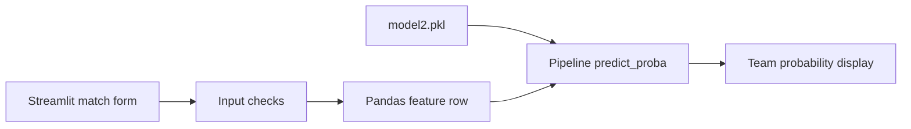

# IPL Win Predictor

**Explore how a chase changes as the score, overs, and wickets change.**

A Streamlit application that turns manually entered IPL match conditions into win-probability estimates using a saved scikit-learn pipeline.

## Why this project

A target alone does not describe a chase. Runs remaining, balls remaining, wickets, teams, and venue all provide context. This project makes those inputs visible and shows the feature row sent to the model, making it useful for learning how a prediction pipeline connects to an interactive UI.

## What it does

- Accepts batting and bowling teams, host city, target, score, overs, and wickets lost.
- Derives runs remaining, balls remaining, wickets remaining, current run rate, and required run rate.
- Displays the model input as a table before presenting probabilities for both teams.
- Checks several invalid inputs, including identical teams and zero overs.

## Run locally

Download the repository from GitHub and extract it. From its root:

```bash
python3 -m venv .venv
source .venv/bin/activate
python -m pip install -r requirements.txt
python -m streamlit run app.py
```

On Windows, activate with `.venv\Scripts\activate`. Keep `model2.pkl` in the working directory; this is the artifact loaded by `app.py`. The requirements pin scikit-learn to `1.3.2`, which matters when loading a serialized model.

## Example

Choose two different teams, then enter a target of `180`, a score of `100`, `12` overs, and `3` wickets lost. Select **Predict Probability** to inspect the derived features and model output. The output is computed at runtime; no fixed probability is promised for this example.

## Architecture



## Repository guide

| File | Role |
| --- | --- |
| [app.py](app.py) | UI, feature calculation, and inference |
| [app.ipynb](app.ipynb) | Notebook included with the project |
| [model2.pkl](model2.pkl) | Pipeline used by the app |
| [matches.csv](matches.csv) and [deliveries.csv](deliveries.csv) | Included match data |
| [requirements.txt](requirements.txt) | Runtime dependencies |

Additional model artifacts and cricket datasets are included for exploration.

## Current scope

This is an educational prediction demo with manual inputs, not a live match feed. The team and city lists are fixed in source. Overs are treated as decimal numbers in the feature formula, so conventional cricket notation such as `12.3` is not interpreted as twelve overs and three balls. Calibration and evaluation results are not documented in this README; probabilities should be understood in that context.
